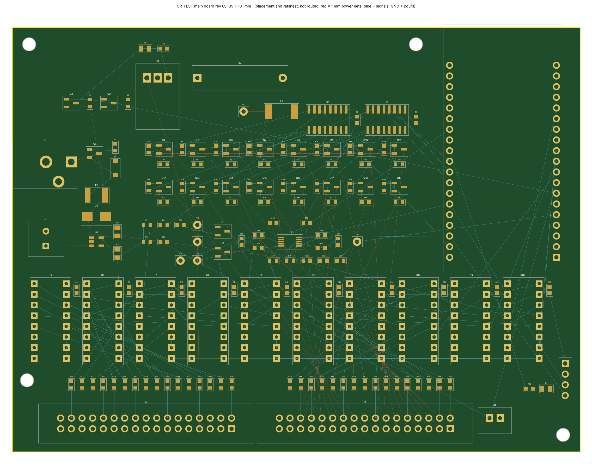

# KiCad projects, board rev C

| Folder | Board | Size | Status |
| --- | --- | --- | --- |
| `crkit_main/` | Main board: LM317T current source, 16 pin switches, 10× CD4053BE sense muxes, ADS1115, ESP32-DevKitC socket | 135 × 101 mm, 2 layers, 2 oz | Schematic complete. PCB placed, nets and net classes set, GND pours on both layers. **Not routed** |
| `crkit_jack_female/` | RS16P-T socket + 2×17 IDC | 80 × 40 mm | Schematic complete. PCB placed. **Not routed** |
| `crkit_jack_male/` | RP16-T plug + 2×17 IDC | 80 × 40 mm | Schematic complete. PCB placed. **Not routed** |
| `crkit.kicad_sym`, `crkit.pretty/` | Symbols and footprints used by all three (also embedded in each file) | | |
| `preview/` | PNG previews of the schematic and of each placement with its ratsnest | | |

All files are written by `hardware/scripts/kicad_gen/build_all.py` (KiCad 8 format). The design lives
in the scripts: `main_board.py` (netlist + placement), `jack_board.py`, `lib.py` (symbols and footprints).
To change the design, edit the script and run `python build_all.py`, or open the files in KiCad and keep
editing there (then stop regenerating, or your KiCad edits will be overwritten).

The files were generated without KiCad (no KiCad in the build environment). They follow the KiCad 8 file
format and pass a structural check, but **open them in KiCad 8 or newer and run ERC and DRC before
anything else.** Schematic style: every part is a box symbol, and every pin ends in a short wire with
a net label, so the netlist is exact and easy to check against `docs/design.md`.

## Rev C changes (23 Nov 2026)

| Change | Parts |
| --- | --- |
| Test current from an **LM317T** constant-current source: R_SET 2.0 Ω 3 W → 0.625 A. Replaces R_HI, R_LO and the ACS712 | U2, R4, C4, C5 |
| Current measured on a **0.1 Ω 1 % shunt** (2512) by the ADS1115 (AIN2−AIN3, Kelvin taps) | R5, R74, R75, C19 |
| Sense muxes: two 16-to-1 trees of **CD4053BE** (15 switches each: S0 / S1 / S2 / S3 by level) replace the CD74HC4067s | U5–U9 (female), U10–U14 (male), C8–C17 |
| **INA333, OPA333 REF buffer and gain jumper removed**: the ADS1115 reads the contact differentially at ±0.256 V | U15, R72, R73, C18, D3, D4 |
| 32 BAT54S input clamps removed: 10 kΩ per sense line into the 3.3 V muxes (bleeder R70), clamps only at the ADC | R38–R70 |
| 5 V monitor moved from ADS1115 AIN2 to ESP32 IO34 | R79, R80, C21 |
| Board 135 × 90 → 135 × 101 mm | |

Rev B changes still in place: reverse-polarity MOSFET (Q1), 10 kΩ sense resistors, 3.3 kΩ bleeder,
ribbon pins 33/34 not connected.

## Reference map (docs → KiCad references)

| Docs | KiCad | Docs | KiCad |
| --- | --- | --- | --- |
| Q_REV | Q1 | Q_DRV 2N7002 | Q2 |
| Q_EN AO3401A | Q3 | Pin switches 1…16 | Q4…Q19 (contact n = Q(n+3)) |
| LM317T | U2 | R_SET 2.0 Ω / R_SH 0.1 Ω | R4 / R5 |
| AP2112K LDO | U1 | 74HC595 ×2 | U3, U4 |
| CD4053BE female tree | U5–U9 | CD4053BE male tree | U10–U14 |
| ADS1115 | U15 | ESP32-DevKitC | U16 |
| Barrel jack | J1 | IDC to female / male board | J2 / J3 |
| Mate switch | J4 | I²C spare | J5 |
| Sense resistors 10 k | R38–R69 | Test points | TP1 LO_RTN, TP2 GND, TP3 F_BUS, TP4 SENSE_F, TP5 SENSE_M, TP6 V5_MON |

## Main board placement

- Top: LM317T (U2, vertical TO-220 with a clip-on heatsink), R_SET (R4, mount 2 mm off the board),
  current switch Q2/Q3, shunt R5, shift registers U3/U4.
- Left: power input (J1 on the board edge, Q1 reverse protection, F1, D2 TVS, C1, LDO U1).
- Centre: two rows of 8 pin switches with their gate resistors and pull-downs.
- Middle: ADS1115 (U15) with its input filters and clamps, pull-ups, 5 V monitor, test points.
- Lower: one row of ten CD4053BE, female tree on the left (U5–U9), male tree on the right (U10–U14),
  a 100 nF decoupler beside each.
- Bottom: 10 k sense resistors straight above their IDC columns. J2/J3 are turned 180° so the sense row
  faces the resistors. **Pin 1 is at the right-hand end** of both headers.
- Right: ESP32-DevKitC on two 1×19 sockets 25.4 mm apart, USB end over the top edge.

## Routing (next step)

Net classes are set in the project: **Power** 1.0 mm / 0.3 mm (F_BUS, LO_RTN, I_HI, ACS_IP, +5V, VIN_*,
MF1–MF16, GND, LM_IN, LM_OUT) and **Sense** 0.25 mm (SF/SM, SFC/SMC, tree nodes, SENSE_F/M, ADS and shunt taps). Default 0.25 mm / 0.2 mm.

1. Open `crkit_main.kicad_pro` in KiCad 8+. Run **Inspect → Electrical Rules Checker** on the schematic, then
   **Tools → Update PCB from Schematic** (should report no changes) and **DRC** (unrouted only).
2. Route by hand first: F_BUS (R_SET/LM317T ADJ → J2 odd row) and LO_RTN (16 sources → R5) as wide pours or 1.5 mm
   traces on the top layer; the R5 return goes straight to the J1 ground, and the two R5 ADC taps are separate thin traces.
3. Then autoroute the rest: **File → Export → Specctra DSN**, route it in Freerouting, then
   **File → Import → Specctra Session**. Keep SENSE_F and SENSE_M as a tight pair over unbroken ground.
4. Press **B** to refill the GND pours and run DRC again.
5. Jack boards: the force (odd) and sense (even) trace of each contact must leave the pad on opposite sides
   and meet only at the pad. Contacts 9–16 are on the far row, so use both layers.

## Check before ordering PCBs

- Footprints against real parts: RP16-T / RS16P-T sample, CUI PJ-002A barrel jack drawing,
  your ESP32-DevKitC (row spacing 25.4 mm, pinout of V4), the LM317T heatsink outline, the 3 W R_SET lead spacing.
- ERC, DRC, and a 1:1 paper print of each board with the connector and the DevKitC laid on it.
